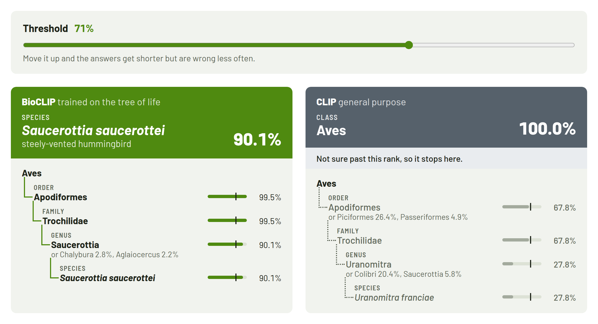
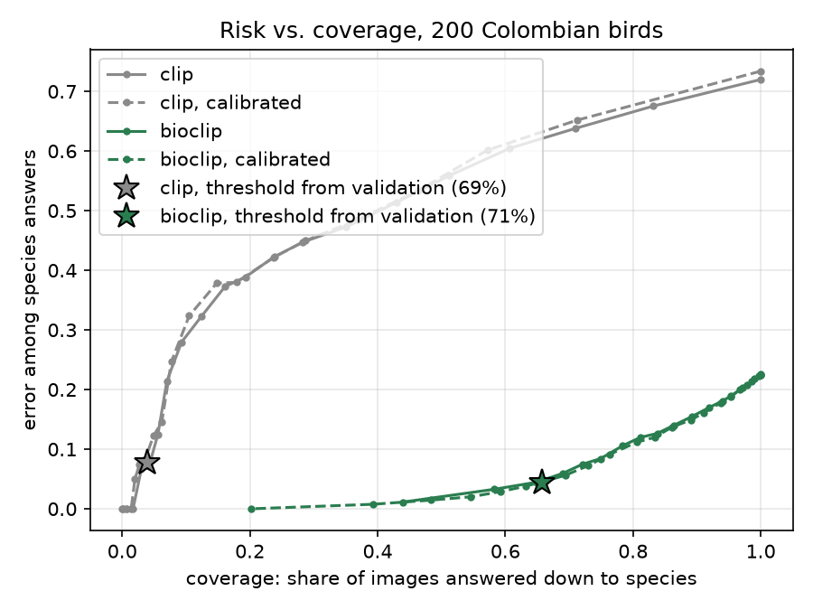
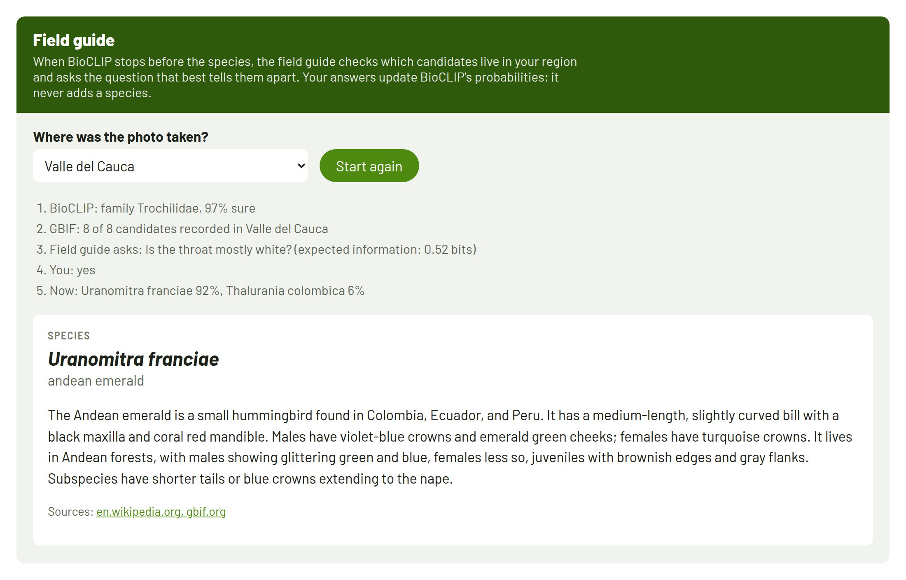

# bioclip-colombia

**A species classifier that knows when to say "I'm not sure", tested on the birds of Colombia.**



Show a general-purpose vision model a photo of a hummingbird and it will often say "a bird", or name the wrong
species with a lot of confidence. [BioCLIP](https://imageomics.github.io/bioclip/) (CVPR 2024) fixes a big part of that.
It's a CLIP model trained on 10 million images of living things, where the caption of every image is its full taxonomy:
*Animalia Chordata Aves Apodiformes Trochilidae Amazilia tzacatl*. Related species share almost all of that text, so the
model ends up learning the shape of the tree of life, and it can recognize species it never saw.

But like any classifier, BioCLIP always names a species, even when it's guessing.
This project takes the paper and adds what a biologist would do:
**if you can't tell the species, say the genus or the family, and say how sure you are.**

It's project 1 of *Paper → Product*, a series where I take a recent AI paper, reproduce part of it,
add something of my own and build it the way it would work in the real world.

## How it works

1. **Zero-shot classification.** Every candidate species becomes a sentence
   (`a photo of Animalia Chordata Aves ... Amazilia tzacatl with common name rufous-tailed hummingbird`).
   The photo and all the sentences go through BioCLIP, and a softmax over their similarities gives one probability per species.
2. **Add it up the tree.** A genus is as likely as the sum of its species, a family as the sum of its genera,
   and so on up to the kingdom.
3. **Walk down with a threshold.** Start at the kingdom and go down one rank at a time, always taking the most likely child.
   As soon as the best option drops below the threshold, stop and answer with the last rank you were sure about.

```
$ uv run first_look.py data/samples/saucerottia_saucerottei_anori.jpg --candidates data/candidates/aves_colombia.csv

== clip ==
     32.5%  andean emerald (Uranomitra franciae)
     29.9%  rufous-tailed jacamar (Galbula ruficauda)
  answer at 80%: class Aves (100.0%)  <- not sure about the species

== bioclip ==
     98.8%  steely-vented hummingbird (Saucerottia saucerottei)
  answer at 80%: species Saucerottia saucerottei (98.8%)
```

CLIP's second guess there is a jacamar, a bird from a different order, so the only thing it can honestly say is "a bird".

## What I found

I built a test set of **1,000 photos of the 200 most observed birds in Colombia**, 5 per species, all from
iNaturalist and all taken in 2024 or later, so BioCLIP can't have seen them during training.
No training and no tuning: both models are used zero-shot.

**How often the top guess is right, at each rank:**

| | order | family | genus | species |
|---|---:|---:|---:|---:|
| CLIP | 78.0% | 59.5% | 32.9% | 29.1% |
| BioCLIP | **93.1%** | **87.1%** | **80.2%** | **77.8%** |

**What the threshold buys you.** Each point on the plot is a threshold. Moving right means answering more photos down
to species; moving up means more of those answers are wrong.



**Picking the threshold honestly.** Sweeping a threshold over the test set and picking the best one would be cheating,
so I built a second set of 1,000 photos for validation (none shared with the test set). On it I calibrated BioCLIP
with temperature scaling and picked the threshold that answers the most photos down to species while keeping
wrong answers at or below 5%. That came out at **71%**. Then, once, on the test set:

- BioCLIP names the species for **65.7%** of the photos, and **4.1%** of all its answers are wrong
  (22.5% when it's forced to always name a species). The rest stop at genus, family or order.
- CLIP at its own validation threshold reaches species on 3.9% of the photos.

A few things I didn't expect:

- **BioCLIP is overconfident out of the box.** 29 of its wrong answers come with more than 90% probability.
  Temperature scaling brings that down to 7, and its calibration error from 0.077 to 0.027. It doesn't move the curve,
  though: it changes how sure the model says it is, not which photos it's more sure about.
- **Its mistakes aren't milder, there are just fewer of them.** A wrong BioCLIP species shares, on average, 4.2 of 7 ranks
  with the right one. CLIP: 4.0. About a third of BioCLIP's mistakes already pick the wrong order.
- **Some confusions make total sense** (two black-and-red woodpeckers, two kingfishers of the same genus), and some
  are just color: a yellow warbler called a saffron finch, four times out of five.
- **The image space alone is already organized.** For each photo, 54% of its 10 nearest photos in BioCLIP's space are from
  the same family (CLIP: 36%), and 29% from the same genus (CLIP: 15%).

The full notes, with the caveats and the UMAP plot, are in [results/aves_colombia](results/aves_colombia/README.md).

## The demo

A web app to try it with your own photos: upload a bird, both models walk down the tree side by side,
and a slider moves the threshold (it starts at the 71% picked on validation). The branches stay solid while a model
is sure and turn dotted where it stops.

- **Backend:** FastAPI ([`entrypoints/api.py`](src/bioclip_co/entrypoints/api.py)). `POST /classify` returns the probability
  of every node of the tree for both models, once per photo.
- **Frontend:** React + Vite + TypeScript ([`web/`](web/)). The threshold is applied in the browser
  ([`tree.ts`](web/src/tree.ts) is the same walk as [`abstention.py`](src/bioclip_co/domain/abstention.py)),
  so moving the slider never calls the server.

## The field guide agent

When BioCLIP stops before the species (about a third of the photos), an agent takes over and asks you about what you see.
It's a LangGraph graph; the questions come from probability, not from a language model:



1. **Region.** If you say where the photo was taken, it asks GBIF which candidates have been recorded in that department
   and drops the others.
2. **The most informative question.** Every species has field marks (crown, throat, belly, back and tail colour; bill and
   tail shape) that a vision-language model read off 5 validation photos each, kept only when 3 of 5 photos agree.
   The agent asks the yes/no question with the largest expected information gain over the candidates, weighted by
   BioCLIP's probabilities. A feature every likely candidate shares is worth 0 bits and is never asked.
3. **Bayes' rule.** Your answer updates the candidates' probabilities; LangGraph pauses the graph (`interrupt`) until you
   answer. When one species passes the threshold it stops, otherwise it asks again (up to 3 questions) or stays at the
   genus or family.
4. **Card.** A local LLM (Qwen3 4B through Ollama) writes a short field-guide entry, only from the cited Wikipedia text,
   with the IUCN category. For threatened species the page says the exact location is hidden.

**Does it help?** With a simulated person who answers from the true species' field marks, it turns 61% of the unsure
photos into the right species with about two questions. Over all 1,000 test photos, right species go from 62.8% to
83.6%, and wrong answers from 4.1% to 7.9%: a real trade, and the best case, since the simulated person agrees with the
field guide. Details and the noisy-person numbers in [results/agent](results/agent/README.md).

**How I got here.** My first agent had the LLM write the questions and judge the answers. It asked about features every
candidate shared and once chose the species the answer had just ruled out. Then I had it extract field marks from
Wikipedia text, and it filled the gaps by guessing (a white belly for the yellow-bellied great kiskadee). Looking at
photos, voting, and choosing questions by information gain fixed both.

## Why not just ask a multimodal LLM?

I asked one: Qwen3-VL 8B, locally, on the same 200 test photos (one per species).

| | species accuracy (pick 1 of 200) | knows when it's guessing? |
|---|---:|---|
| Qwen3-VL 8B, ~8,000 M parameters | 30.5% | no: says "95% sure" on 184 of 200 photos, wrong on 67% of them |
| BioCLIP, ~150 M parameters | **80.5%** | yes: 1.5% wrong answers at the calibrated threshold |

Without the list of candidates it names the right species 18% of the time, and in 71% of the photos it names a bird
that isn't one of the 200 candidates. A specialist 50 times smaller is more than twice as accurate and its confidence
means something; the general model is better used for what it's good at, like describing colours in a photo.
[results/vlm](results/vlm/README.md)

## Serving and MLOps, all on this machine

| | what | where |
|---|---|---|
| **ONNX** | PyTorch vs. ONNX vs. INT8: ONNX is ~2× faster on CPU for the same accuracy; INT8 is 4× smaller and costs 4.5 points. Quantizing the text encoder broke the model (78% → 38%), so only the image encoder is INT8 | [results/serving](results/serving/README.md) |
| **MLflow** | every quality-gate run logged with its metrics; a model that passes is registered as a new version of `bioclip-colombia` (a pyfunc model you can load and call) | [`quality_gate.py`](scripts/quality_gate.py) |
| **Jenkins** | tests → web build → model quality gate on the GPU → Docker image. Run it with `MODEL=clip` and the gate blocks it | [`Jenkinsfile`](Jenkinsfile), [`quality_gate.json`](quality_gate.json) |
| **Docker** | the API with CPU-only torch and the weights inside, so it starts without internet | [`Dockerfile`](Dockerfile) |
| **AWS SAM** | the classifier as a Lambda on ONNX Runtime with precomputed text embeddings (no torch), tested with `sam local invoke`, not deployed | [`template.yaml`](template.yaml) |

## Run it yourself

```bash
git clone https://github.com/Gaova777/bioclip-colombia.git
cd bioclip-colombia
uv sync
uv run pytest -q
uv run first_look.py data/samples/amazilia_tzacatl_yarumal.jpg --candidates data/candidates/aves_colombia.csv
```

The first run downloads the BioCLIP and CLIP weights (about 600 MB each). It works on a CPU and uses the GPU if there is one.

Each service runs in its own terminal with [`run.sh`](run.sh):

```bash
./run.sh ollama     # local LLM for the agent's cards (after: ollama pull qwen3:4b-instruct)
./run.sh api        # http://localhost:8000
./run.sh web        # http://localhost:5173
./run.sh mlflow     # http://localhost:5000
./run.sh jenkins    # http://localhost:8080
```

To rebuild the data and the results (the photo sets take ~15 minutes each because the iNaturalist API is rate limited;
the rest takes seconds to minutes on a GPU):

```bash
uv run scripts/build_testset.py data/candidates/aves_colombia.csv -k 5
uv run scripts/build_testset.py data/candidates/aves_colombia.csv -k 5 -o data/valset --exclude data/testset/manifest.csv
./run.sh evaluate && ./run.sh calibrate && ./run.sh evaluate
uv run --group analysis scripts/embedding_map.py
uv run scripts/field_marks.py && uv run scripts/evaluate_agent.py      # needs ./run.sh ollama
uv run scripts/evaluate_vlm.py --one-per-species                         # after: ollama pull qwen3-vl:8b-instruct
./run.sh onnx
./run.sh gate
./run.sh lambda
```

## How the code is organized

The code follows a clean-architecture split, so the interesting logic can be read and tested without loading a model:

```
src/bioclip_co/
├── domain/          plain Python, no ML libraries
│   ├── taxonomy.py      Taxon, adding probabilities up the tree
│   ├── abstention.py    walking down the tree with a threshold
│   ├── metrics.py       accuracy per rank, mistake depth, risk-coverage, calibration error
│   └── field_marks.py   the most informative question, Bayes' rule, majority vote over photos
├── ports/           what the app needs from the outside: an image-text encoder, an encyclopedia,
│                    occurrence records, a field-guide writer (the LLM)
├── adapters/        OpenCLIP, ONNX Runtime, GBIF, Wikipedia, Ollama (text and vision), the candidates CSV
├── application/     zero-shot probabilities, calibration, the LangGraph field guide
└── entrypoints/     FastAPI app, AWS Lambda handler, MLflow model
scripts/             build the photo sets, evaluate, calibrate, field marks, agent and VLM evaluations,
                     export to ONNX, benchmark, quality gate
web/                 the React demo
tests/               61 tests; none of them loads a model or calls an API
```

Swapping models is writing an adapter: the ONNX version sits behind the same port as the PyTorch one, and the tests
plug in a fake encoder, a fake LLM and fake GBIF/Wikipedia.

## Things that didn't work (yet)

- My first test set had zero photos of *Tyrannus tyrannus*. Searching iNaturalist by name returned other *Tyrannus*
  species, and my filter threw them all away. Photos are now looked up by taxon id.
- The silhouette score said nothing about the embedding space (near zero for both models); neighbor agreement did.
- Quantizing the whole model to INT8 halved its accuracy (above).
- Letting an LLM write the agent's questions, and extracting field marks from Wikipedia text (see the agent section).
- The GBIF filter didn't help in the department I tried most (Valle del Cauca): it's so well surveyed that every
  candidate had records there.
- Five photos per species is enough for the totals, not for per-species conclusions.

## Roadmap

- [x] Zero-shot CLIP vs. BioCLIP on Colombian birds
- [x] Marginalization and hierarchical abstention, with tests
- [x] Metrics: accuracy per rank, mistake depth, risk-coverage
- [x] Full evaluation on a 1,000-photo iNaturalist test set
- [x] Web demo: FastAPI + React, Docker image for the API
- [x] Threshold picked on a validation set, BioCLIP calibrated
- [x] Embedding space: UMAP and nearest-neighbor agreement
- [x] ONNX / INT8: size, latency and accuracy
- [x] Field guide agent: LangGraph, region filter, questions chosen by information gain, Bayes' rule
- [x] Agent evaluated with simulated people; a local multimodal LLM compared against BioCLIP
- [x] Jenkins pipeline with a model quality gate, MLflow tracking and registry
- [x] AWS SAM template, tested locally
- [ ] Try my own photos
- [ ] Public demo online

## Data and credits

- Candidate species and test photos come from [iNaturalist](https://www.inaturalist.org/), Colombia only.
- Every image has its author and license, in [data/samples/CREDITS.md](data/samples/CREDITS.md) and in the test set
  [manifest](data/testset/manifest.csv). The test images themselves are not redistributed in this repo.
- Models: [BioCLIP](https://huggingface.co/imageomics/bioclip) and OpenAI CLIP ViT-B/16, through
  [OpenCLIP](https://github.com/mlfoundations/open_clip).

## Reference

Stevens, S., Wu, J., Thompson, M. J., et al. *BioCLIP: A Vision Foundation Model for the Tree of Life.* CVPR 2024.
[arXiv:2311.18803](https://arxiv.org/abs/2311.18803)
